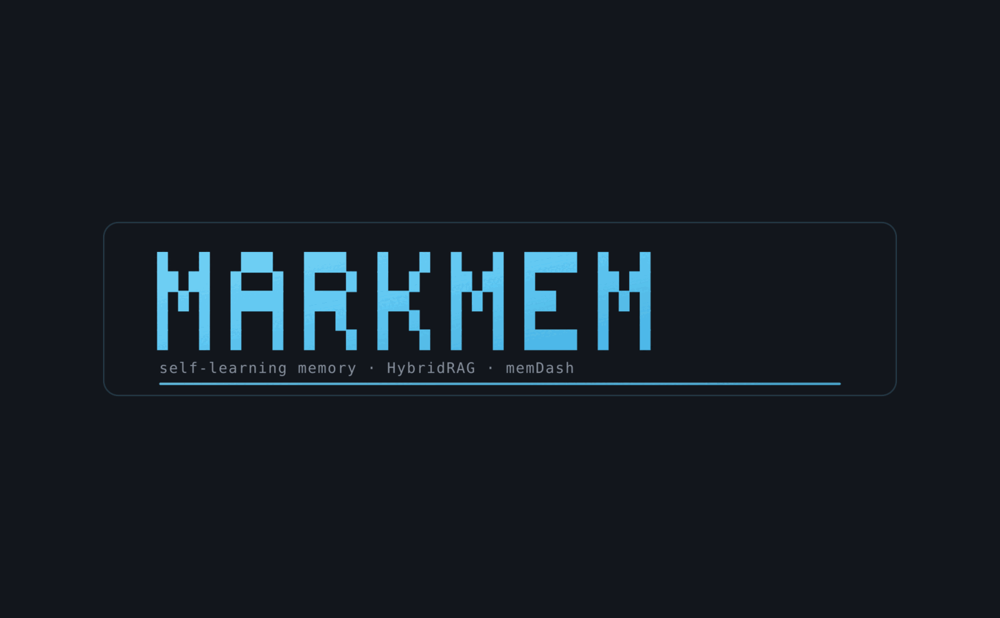
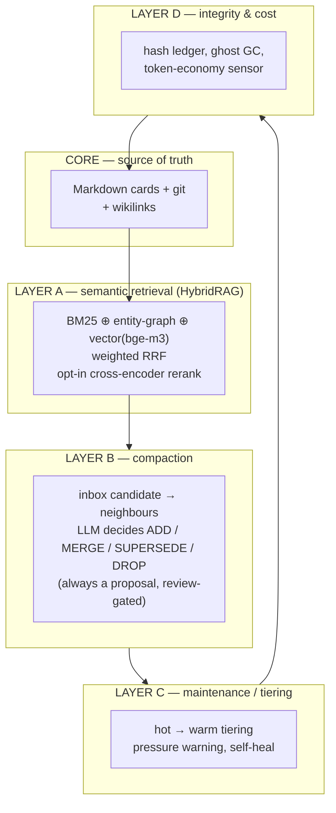
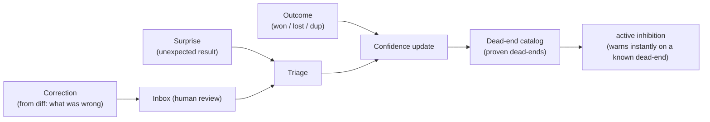

<p align="center"></p>

<p align="center">
  
  
  
  
  
  
</p>

<p align="center">
  <em>A self-learning, self-tuning AI memory on Markdown + git — an AI memory an auditor can read.<br/>
  HybridRAG retrieval, a real learning loop, and nothing written to memory without human review.</em>
</p>

<p align="center">
  <a href="#why">Why</a> · <a href="#how-it-compares">Compare</a> · <a href="#architecture">Architecture</a> · <a href="#quickstart">Quickstart</a> · <a href="#retrieval">Retrieval</a> · <a href="#learning-loop">Learning</a> · <a href="#privacy">Privacy</a> · <a href="README.de.md">Deutsch</a>
</p>

<hr>

<a id="why"></a>
## Why markmem

Most agent-memory systems compete on raw capability — bigger vector stores, more extraction, higher
benchmark numbers. markmem competes on something the incumbents largely skip: **can you trust what the
memory did, and can you read it afterwards?**

- **Plain Markdown + git is the single source of truth.** Every memory is a human-readable `.md`
  card; every change is in the git log. All indexes (vector, graph, tiers) are *derived* and
  rebuildable from the Markdown. A crash is a reindex, not a data-loss event.
- **Nothing is written to memory without human review.** Every learned candidate — correction,
  surprise, outcome — lands in an inbox and waits for a human to promote it. No script silently
  mutates the store. This is the structural answer to memory poisoning and hallucinated "facts".
- **It runs local, offline, and fail-open.** No daemon, no heavy vector DB, no vendor lock, no
  outbound call by default. If a component is down, retrieval degrades cleanly instead of breaking.

> **The honest one-liner:** markmem is a *governed, auditable, local-first* memory for agentic
> workflows. It will not out-scale mem0 or Zep, and it does not try to — it is the memory you reach
> for when "an auditor can read it" matters more than raw throughput.

<p align="center"></p>

<hr>

<a id="how-it-compares"></a>
## How it compares

Honest framing — the incumbents are mature and have thousands of stars; markmem is `alpha`. The point
of this table is *design philosophy*, not a capability contest.

| | **markmem** | mem0 / Zep | Letta MemFS | Basic Memory |
|---|---|---|---|---|
| Source of truth | **Markdown + git** | vector DB / graph + platform | git-backed Markdown | Markdown |
| Writes to memory | **human review gate** | automated extraction | automated | automated |
| Negative knowledge (proven dead-ends) | **yes — active inhibition** | — | — | — |
| Runs with no daemon / no heavy DB | **yes** | DB / managed service | server | local-first |
| Fail-open retrieval | **yes** | varies | — | varies |
| Eval honesty | **rejects its own unproven ideas** | benchmark-led | research-led | — |
| Scale & traction | alpha, small | large, production | large | growing |

Where markmem is genuinely different: the **human-review gate**, **dead-end inhibition** (it learns
from what *failed*, which almost every system throws away), and an **eval harness that overrules its
own author** (see [Self-tuning](#self-tuning)). Where it is weaker: it is young, Claude-Code-coupled,
and while a reproducible public benchmark now ships, it is small — the headline vector-lift numbers
still come from a private corpus and are directional, not a leaderboard result (see
[Retrieval](#retrieval)). We would rather say that than inflate it.

<hr>

<a id="architecture"></a>
## Architecture

Five layers over a Markdown core, loaded through **two separate channels**.



> [!IMPORTANT]
> **The core innovation — two-channel loading.** The critical behavior rules alone are ~24 KB and
> would overflow the hard size cap of the always-loaded `MEMORY.md`, silently truncating the most
> important rules at the bottom. markmem puts the rules in their own file and injects them through a
> **separate context channel** (a SessionStart hook) that the cap does not touch. Result: **nothing
> critical is ever truncated**, and both files stay small.

Full description: [docs/architektur.md](docs/architektur.md).

<hr>

<a id="quickstart"></a>
## Quickstart

```bash
# 1. install with the vector extra (numpy + wcwidth)
pip install -e ".[vektor]"

# 2. run against the shipped synthetic corpus
bash examples/quickstart.sh
```

`examples/quickstart.sh` indexes the demo corpus under `examples/memory/`, runs a sample query, and
opens the dashboard — all on synthetic data, no private notes required.

> [!TIP]
> **Vector leg prerequisite:** a local [Ollama](https://ollama.com) with the `bge-m3` embedding model
> (`ollama pull bge-m3` — multilingual, runs on CPU). Without it, markmem still runs: retrieval
> **fails open** to BM25 ⊕ entity. Point it at your own memory with `MARKMEM_MEMORY_DIR`
> (see [docs/konfiguration.md](docs/konfiguration.md)).

<hr>

<a id="retrieval"></a>
## Retrieval (HybridRAG)

Retrieval fuses three (optionally four) independent rankings:

- **BM25** — classic term frequency; catches exact hits and abbreviations. *Always on.*
- **Entity graph** — 1-hop expansion over `[[wikilinks]]` and co-occurrence edges. *Always on.*
- **Vector** — bge-m3 embeddings (1024d), numpy brute-force cosine. This is the "finds it sideways":
  an English query hits a German card. *Default on.*
- **Cross-encoder rerank** — `bge-reranker-v2-m3`, top-20 → top-5. *Opt-in.*

Lists are merged via **weighted Reciprocal Rank Fusion**, optionally modulated by a confidence prior.
Both the reranker *and* the prior are **data-gated**: the tuner measured that they do not pay their way
as defaults on the tested corpus (see the honest note under [Self-tuning](#self-tuning)).

### Recall@1 — and exactly what it is

Two tables, two jobs. The first anyone can recompute; the second is directional.

**Reproducible public benchmark** — ships in the repo. A frozen gold set of 20 keyword-avoiding
paraphrase queries over the synthetic [`examples/`](examples/) corpus, scored deterministically with
95 % bootstrap confidence intervals. No LLM, no Ollama, byte-identical on every run:

```bash
export MARKMEM_MEMORY_DIR=examples/memory MARKMEM_GRAPH=examples/graph/graph.json
markmem-eval --goldset examples/eval/goldset.json   # BM25 + entity, Ollama-free
```

| Metric | Value | 95 % CI |
|---|---|---|
| recall@1 | 0.900 | [0.750, 1.000] |
| recall@3 | 0.950 | [0.850, 1.000] |
| recall@5 | 1.000 | [1.000, 1.000] |
| MRR | 0.938 | [0.838, 1.000] |

> [!NOTE]
> This proves the harness is **real and reproducible** — not that the vector leg dominates here. The demo
> corpus is small and topic-distinct, so lexical retrieval already scores high and leaves the vector leg
> little headroom. The vector/rerank *lift* shows on a larger, more homogeneous corpus — the directional
> table below.

**Directional** — private corpus, not independently reproducible.

> [!WARNING]
> Measured on a *private* corpus with a small gold set (n ≈ 30–35, keyword-free paraphrase queries).
> These are **not** a public result — read them as "the direction the design moves", not a leaderboard
> claim. The self-tuner now reports on a **held-out split**
> ([`markmem-tune --holdout-frac`](src/markmem/eval/tune_retrieval.py)), so tuning can no longer score
> its own training data.

| Configuration | Recall@1 | MRR |
|---|---|---|
| BM25 + entity (baseline) | 0.73 | 0.79 |
| **+ vector leg (default)** | **0.87** | 0.88 |
| + cross-encoder (opt-in) | **0.93** | 0.93 |

Details: [docs/retrieval.md](docs/retrieval.md).

<hr>

<a id="learning-loop"></a>
## Learning loop

markmem learns from what actually happens — not only from what is added. Five pillars:



The distinctive part is **active dead-end inhibition**: proven dead-ends — the negative knowledge
almost every system discards — are harvested into a semantic register, and the hook **warns
immediately** when a new goal resembles an old failure. Everything learned stays a *proposal* until a
human promotes it. Details: [docs/lern-schleife.md](docs/lern-schleife.md).

<hr>

<a id="self-tuning"></a>
## Self-tuning

The system closes the loop on itself: it **measures** its own retrieval quality and **sets its own
weights** accordingly (`markmem-eval` → `markmem-tune` → versioned config → re-eval).

> [!NOTE]
> **The honest lesson.** The eval harness separates "sounds clever" from "is measurably better". Two
> plausible in-house ideas — a confidence prior and the reranker-as-default — were *disproven by the
> data* and deliberately left off (prior: no effect on the corpus; reranker: +6.6% but 20–60s CPU). A
> system that can reject its own good ideas when the numbers say no is worth more than one that ships
> every idea. Details: [docs/self-tuning.md](docs/self-tuning.md).

<hr>

## Core commands

| Entry point | What it does |
|---|---|
| `memdash` | responsive, colored live terminal dashboard of the whole memory state |
| `markmem-index` | full/incremental embedding of all cards (stale-chunk discipline, secret redaction) |
| `markmem-retrieve` | HybridRAG retrieval: BM25 ⊕ entity ⊕ vector + RRF (+ opt-in rerank) |
| `markmem-compact` | compaction: fetch neighbours → LLM proposal DROP / MERGE / ADD / SUPERSEDE |
| `markmem-tier` | hot → warm tiering, keeps the always-loaded `MEMORY.md` under its cap |
| `markmem-eval` | eval harness: Recall@1 / MRR against a paraphrase gold set |
| `markmem-tune` | self-tuner: grid-search of weights + prior against Recall@1 |
| `markmem-deadends` | harvests proven dead-ends into a semantic inhibition register |
| `markmem-corrections` | learns from files you silently edited after the assistant → review candidates |
| `markmem-graph` | graph densification (entity nodes + co-occurrence edges) |
| `markmem-audit` | integrity: hash ledger, ghost GC, orphan clusters |
| `markmem-status` | one-screen pulse check (token tax, tiers, confidence trends) |
| `markmem-contextscore` | usage-based grader: which memories are dead-weight vs. load-bearing |

<hr>

<a id="privacy"></a>
## Privacy

> [!WARNING]
> **Real memory databases never belong in the repo.** Only synthetic `*.sample.md` cards and the demo
> indexes under `examples/` are committed. Real notes live outside the repo (via `MARKMEM_MEMORY_DIR`)
> and stay private. `.gitignore` already blocks `/memory/`, `/data/`, `*.private.md`, all `*.sqlite`
> indexes and generated metrics; the indexer redacts secrets before embedding; and
> `scripts/privacy_check.sh` runs in CI to fail the build on any private marker.

The full trust boundary and an honest list of what markmem does **not** defend against live in
[THREAT_MODEL.md](THREAT_MODEL.md). To report a vulnerability, see [SECURITY.md](SECURITY.md).

<hr>

## Installation / extras

```bash
pip install -e ".[vektor]"   # core + vector leg (numpy, wcwidth) — recommended
pip install -e ".[rerank]"   # + the cross-encoder (torch, transformers)
pip install -e ".[all]"      # vektor + rerank
pip install -e .             # core: pure stdlib (BM25 + entity, no vector)
```

The **core has no dependencies** (pure stdlib). Extras enable the vector leg / reranker.

<hr>

## Claude-Code integration

markmem was built as the memory for an agentic workflow. Its hooks (SessionStart / PreToolUse /
PostToolUse / Stop) inject rules, inhibit dead-ends and harvest corrections — "the bus, not a daemon".
Example hooks and wiring: [integrations/claude_code/](integrations/claude_code/).

<hr>

## License

[MIT](LICENSE). See also [CONTRIBUTING.md](CONTRIBUTING.md), [CHANGELOG.md](CHANGELOG.md),
[SECURITY.md](SECURITY.md) and the [Code of Conduct](CODE_OF_CONDUCT.md).

<p align="center">
  <sub>
  &nbsp;·&nbsp; built with <strong>Python</strong> &nbsp;·&nbsp;
  </sub>
</p>
