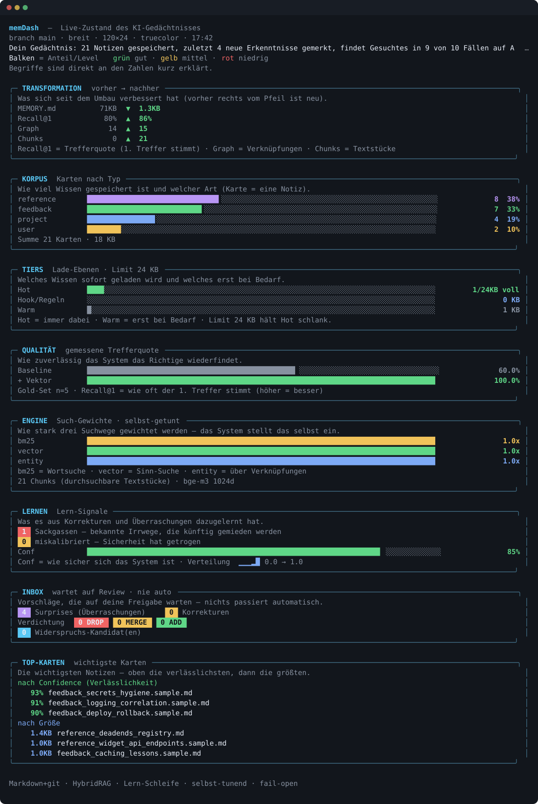
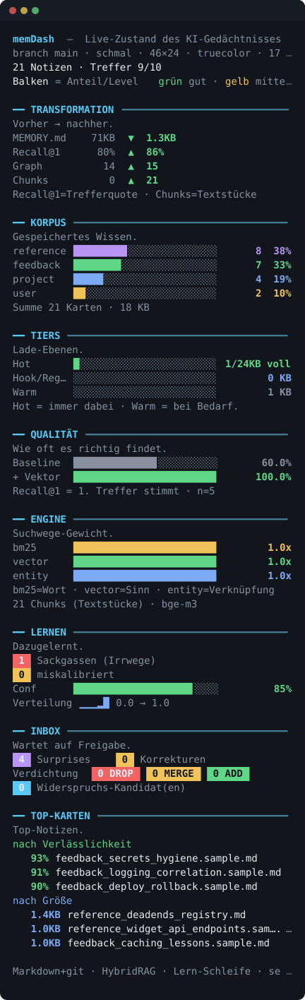
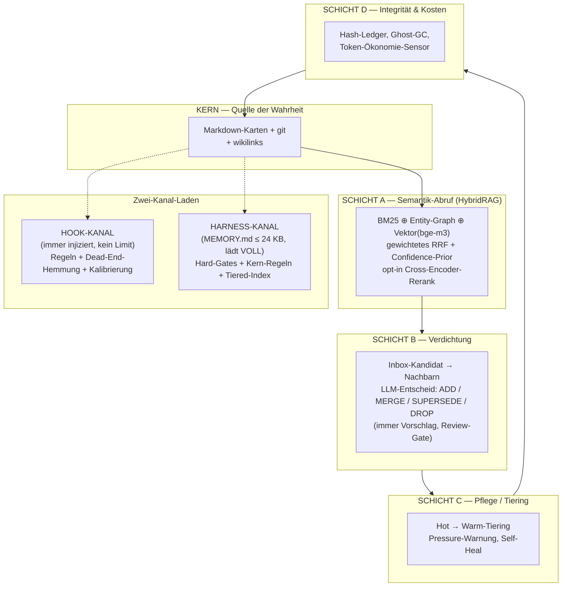
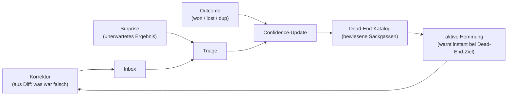
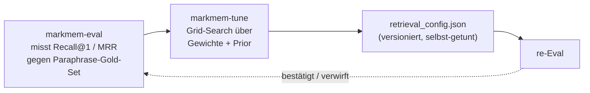

<p align="center"></p>

<p align="center">
  
  
  
  
  
  
  
</p>

<p align="center">
  <em>Ein selbst-lernendes, selbst-tunendes KI-Gedächtnis auf Markdown + git — HybridRAG-Abruf, eine echte Lern-Schleife und ein responsives Terminal-Dashboard. Jede Behauptung ist eine gemessene Zahl, kein Versprechen.</em>
</p>

`markmem` macht aus einem gewachsenen Markdown-Notizsystem ein Gedächtnis, das **semantisch abruft**, **aus Korrekturen lernt**, **sich selbst verdichtet** und **seine eigenen Such-Gewichte gegen eine gemessene Recall-Metrik tunt** — ohne Daemon, ohne schwere Datenbank, ohne Vendor-Lock-in.

<hr>

## memDash — auf einen Blick

`memdash` ist das visuelle Aushängeschild: ein farbiges Terminal-Dashboard, das den kompletten Live-Zustand des Gedächtnisses zeigt — und sich wie eine CSS-Media-Query an die Fensterbreite anpasst.

<p align="center"></p>

<p align="center"><sub>Voller Breit-Modus (≥ 100 Spalten): Transformation, Korpus, Tiers gegen das Lade-Limit, die Recall@1-Treppe, die selbst-getunten Such-Gewichte, Lern-Schicht und Verdichtungs-Inbox.</sub></p>

<table>
  <tr>
    <td align="center" width="40%">
      
    </td>
    <td align="left" width="60%">
      <strong>Dasselbe Dashboard im iPhone-Hochformat — responsiv.</strong><br><br>
      Unter 56 Spalten (z.&nbsp;B. iPhone-Hochformat über SSH) fällt <code>memdash</code> in den schmalen Modus: ohne Boxen, gestapelt, jede Zeile bleibt im Fenster.<br><br>
      Drei Modi (schmal / mittel / breit), Unicode-korrekte Spalten-Fluchtung über <code>wcwidth</code>, Farb-Degradation von Truecolor bis S/W.
    </td>
  </tr>
</table>

<hr>

## Was es ist — und was nicht

**Es ist:**

- **Markdown + git als alleinige Quelle der Wahrheit.** Jede Notiz ist eine menschenlesbare `.md`-Karte, jede Änderung steht im git-Log. Alle Indizes (Vektor, Graph, Tiers) sind *abgeleitet* und jederzeit aus dem Markdown neu baubar. Crash = Reindex.
- **HybridRAG-Abruf** — BM25 ⊕ Entity-Graph ⊕ Vektor (bge-m3), fusioniert per gewichtetem Reciprocal Rank Fusion, mit optionalem Cross-Encoder-Rerank.
- **Eine vollständige Lern-Schleife** — Korrektur, Surprise, Outcome, Dead-End-Hemmung, Kalibrierung.
- **Selbst-tunend** — ein Eval-Harness misst Recall@1, eine Grid-Search optimiert die Such-Konfiguration, das System richtet sich an seiner eigenen Metrik aus.

**Es ist nicht:**

- **Kein Daemon.** Es gibt keinen Hintergrundprozess. Die Integration läuft über Hooks/CLI; Pflege ist ein optionaler Cron. Der „Bus" sind Hooks, kein Server.
- **Keine schwere Vektor-DB.** Kein Milvus, kein ANN-Cluster. Bei wenigen tausend Vektoren ist SQLite-BLOB + numpy-Brute-Force-Cosine schneller einzurichten, kann nicht OOM-sterben und liefert in < 10 ms. Richtig dimensioniert statt überdimensioniert.
- **Nie fail-closed beim Abruf.** Fehlt Ollama, fehlt numpy, ist der Index kalt — der Abruf degradiert sauber (Vektor-Bein fällt weg, BM25/Entity bleiben). Ein Synapsen-Fehler blockiert nie die Session. (Riskante *Schreib*-Aktionen sind dagegen fail-closed.)

<hr>

## Architektur

Fünf Schichten über dem Markdown-Kern, geladen über **zwei getrennte Kanäle**.



> [!IMPORTANT]
> **Die zentrale Innovation — Zwei-Kanal-Laden.** Die kritischen Verhaltensregeln allein sind ~24 KB groß und würden das harte Lade-Limit der immer-geladenen `MEMORY.md` sprengen — mit dem Effekt, dass die wichtigsten Regeln am unteren Rand stillschweigend abgeschnitten würden. `markmem` löst das, indem es die Regeln in eine eigene Datei legt und über einen **eigenen Kontext-Kanal** (SessionStart-Hook) injiziert, der nicht vom Limit betroffen ist. Ergebnis: **nichts Kritisches wird je abgeschnitten**, und beide Dateien bleiben klein.

<details>
<summary><strong>Vollständige Architektur — die fünf Schichten im Detail</strong></summary>

| Schicht | Rolle | Kernmechanik |
|---|---|---|
| **KERN** | Quelle der Wahrheit | Markdown-Karten + git, `[[wikilinks]]` als Graph-Kanten. Alle Indizes sind ableitbar. |
| **A — Semantik-Abruf** | HybridRAG | BM25 ⊕ Entity-Graph ⊕ Vektor (bge-m3), gewichtetes RRF, opt-in Confidence-Prior + Reranker. |
| **B — Verdichtung** | Inbox → Konsolidierung | Nachbarsuche + LLM-Entscheid ADD / MERGE / SUPERSEDE / DROP, immer als Vorschlag hinter Review-Gate. |
| **C — Pflege / Tiering** | Hot → Warm | Hält `MEMORY.md` unter dem Lade-Limit, Pressure-Warnung, Self-Heal. |
| **D — Integrität & Kosten** | Audit | Hash-Ledger, Ghost-GC, Token-Ökonomie-Sensor. |

Volle Beschreibung: [docs/architektur.md](docs/architektur.md).

</details>

<hr>

## Quickstart

```bash
# 1. Installation mit dem Vektor-Extra (numpy + wcwidth)
pip install -e ".[vektor]"

# 2. Demo gegen den mitgelieferten synthetischen Korpus
bash examples/quickstart.sh
```

`examples/quickstart.sh` indiziert den Demo-Korpus unter `examples/memory/`, führt eine Beispiel-Abfrage aus und öffnet das Dashboard — alles auf synthetischen Daten, ohne dass private Notizen nötig sind.

> [!TIP]
> **Voraussetzung für das Vektor-Bein:** ein lokal laufender [Ollama](https://ollama.com) mit dem Embedding-Modell `bge-m3`:
>
> ```bash
> ollama pull bge-m3   # 1024d, multilingual (DE + EN), läuft auf CPU
> ```
>
> Ohne Ollama läuft `markmem` trotzdem — der Abruf fällt **fail-open** auf BM25 ⊕ Entity zurück. Ein eigenes Gedächtnis bindet man über `MARKMEM_MEMORY_DIR` ein (siehe [docs/konfiguration.md](docs/konfiguration.md)).

<hr>

## Kern-Features

Jedes Feature ist ein eigener Konsolen-Befehl (Entry-Point):

| Entry-Point | Was er tut |
|---|---|
| `memdash` | **memDash** — responsives, farbiges Live-Terminal-Dashboard des kompletten Gedächtnis-Zustands |
| `markmem-index` | Voll-/inkrementelles Einbetten aller Karten (Stale-Chunk-Disziplin, Secret-Redaktion) |
| `markmem-retrieve` | HybridRAG-Abruf: BM25 ⊕ Entity ⊕ Vektor + RRF (+ opt-in Rerank) |
| `markmem-compact` | Verdichtung: Nachbar holen → LLM-Vorschlag DROP / MERGE / ADD / SUPERSEDE |
| `markmem-tier` | Hot → Warm-Tiering, hält die immer-geladene `MEMORY.md` unter dem Limit |
| `markmem-eval` | **Eval-Harness:** Recall@1 / MRR gegen ein Paraphrase-Gold-Set |
| `markmem-tune` | **Selbst-Tuner:** Grid-Search der Such-Gewichte + Prior gegen Recall@1 |
| `markmem-deadends` | Erntet bewiesene Dead-Ends in ein semantisches Hemmungs-Register |
| `markmem-graph` | Graph-Verdichtung (Entity-Knoten + Ko-Okkurrenz-Kanten) |
| `markmem-audit` | Integrität: Hash-Ledger, Ghost-GC, Orphan-Cluster |
| `markmem-status` | One-Screen-Pulse-Check (Token-Tax, Tiers, Confidence-Trends) |

<hr>

## HybridRAG / Retrieval

Der Abruf fusioniert drei (optional vier) unabhängige Ranglisten:

- **BM25** &nbsp; — klassische Term-Frequenz, fängt exakte Treffer und Kürzel.
- **Entity-Graph** &nbsp; — 1-Hop-Expansion über `[[wikilinks]]` und Ko-Okkurrenz-Kanten.
- **Vektor** &nbsp; — bge-m3-Embeddings (1024d), numpy-Brute-Force-Cosine. Das ist das „über die Ecke finden": eine englische Frage trifft eine deutsche Karte.
- **Cross-Encoder-Rerank** &nbsp; — `bge-reranker-v2-m3`, top-20 → top-5.

Die Listen werden per **gewichtetem Reciprocal Rank Fusion** zusammengeführt, optional moduliert durch einen **Confidence-Prior** (bewährte Karten ranken höher). Beide — Reranker *und* Confidence-Prior — sind **datenbasiert opt-in bzw. aus**: der Tuner hat gemessen, dass sie sich auf dem getesteten Korpus nicht als Default lohnen (siehe „Ehrliche Lehre" unten).

### Recall@1-Treppe

*Beispielmessung auf einem privaten Korpus (Gold-Set n ≈ 30–35, keyword-freie Paraphrase-Queries). Keine universellen Benchmarks — Zahlen illustrieren die Richtung, nicht ein Versprechen.*

<p align="left">
  
  &nbsp;→&nbsp;
  
  &nbsp;→&nbsp;
  
</p>

| Konfiguration | Recall@1 | MRR |
|---|---|---|
| BM25 + Entity (Baseline) | 0.73 | 0.79 |
| **+ Vektor-Bein (Default)** | **0.87** | 0.88 |
| + Cross-Encoder (opt-in) | **0.93** | 0.93 |
| Selbst-getunt (vector 2.5×) | 0.80 → **0.857** | 0.86 → 0.895 |

Mehr: [docs/retrieval.md](docs/retrieval.md).

<hr>

## Lern-Schleife

`markmem` lernt aus dem, was tatsächlich passiert — nicht nur aus dem, was hinzugefügt wird. Fünf Säulen:



Der entscheidende Teil ist die **aktive Sackgassen-Hemmung**: bewiesene Dead-Ends (das Negativ-Wissen, das fast jedes System wegwirft) werden in ein semantisches Register geerntet, und der Hook **warnt sofort**, wenn ein neues Ziel einem alten Reinfall ähnelt. Korrekturen werden aus dem Diff zwischen Annahme und Ergebnis gelernt. Details: [docs/lern-schleife.md](docs/lern-schleife.md).

<hr>

## Self-Tuning

Das System schließt die Schleife auf sich selbst zurück: es **misst** seine Abruf-Qualität und **stellt seine eigenen Gewichte** danach ein.



Der Tuner darf eigene Ideen **verwerfen**: misst die Grid-Search für einen Parameter keinen Gewinn (z. B. `conf_beta = 0`), bleibt die Infrastruktur dormant statt aktiv zu schaden. Details: [docs/self-tuning.md](docs/self-tuning.md).

> [!NOTE]
> **Die ehrliche Lehre:** Der Eval-Harness trennt „klingt klug" von „ist messbar besser". Zwei plausible eigene Ideen — der **Confidence-Prior** und der **Reranker als Default** — wurden von den Daten *widerlegt* und bewusst *nicht* als Default eingebaut (Prior wirkungslos auf dem Korpus, Reranker +6,6 % aber 20–60 s CPU). Ein System, das seine eigenen guten Ideen verwerfen kann, wenn die Zahlen Nein sagen, ist mehr wert als eines, das jede Idee einbaut.

<hr>

## memDash — das Live-Dashboard

`memdash` zeigt den **kompletten Live-Zustand** des Gedächtnisses auf einen Blick — Transformation, Korpus nach Typ, Tiers gegen das Lade-Limit, die gemessene Recall@1-Treppe, die selbst-getunten Such-Gewichte, die Lern-Schicht und die Verdichtungs-Inbox (siehe Screenshots oben).

```bash
memdash            # Snapshot
memdash --watch    # Live, refresht alle 5 s + sofort bei Resize
```

Drei Eigenschaften machen es zum Aushängeschild:

- **Responsiv wie CSS-Media-Queries.** Es misst die Terminalbreite bei jedem Tick und reagiert auf `SIGWINCH`. Drei Modi: **schmal** (< 56 Spalten, z. B. iPhone-Hochformat über SSH) ohne Boxen, **mittel** (56–99) kompakt, **breit** (≥ 100) mit vollen Rahmen. Keine Zeile wird je breiter als das Fenster (30–120 Spalten getestet).
- **Unicode-korrekt.** Textbreiten werden über `wcwidth` gerechnet — Emojis und Block-Elemente belegen zwei Zellen, die Spalten fluchten überall.
- **Farb-Degradation.** Truecolor → 256 → 16 → S/W, je nach Terminal. Information trägt über **Farbe & Form** (füllende Balken, Sparkline, Chips: DROP rot / MERGE orange / ADD grün), nicht über Emojis.

```bash
# Overrides zum Testen (z. B. den schmalen Modus erzwingen)
COLUMNS=40 MEMDASH_MODUS=schmal MEMDASH_FARBEN=aus memdash
```

Stack: pure Python-stdlib + `wcwidth`, fail-open, kein Daemon.

<hr>

## Konfiguration

Alles wird über `MARKMEM_*`-Umgebungsvariablen aufgelöst (Reihenfolge: **Env > Profil-TOML > Default**). Mitgelieferte Profile: `generic` (Default) und `bugbounty` (Beispiel).

```bash
export MARKMEM_MEMORY_DIR=/pfad/zu/meinen/notizen   # eigenes Gedächtnis einbinden
export MARKMEM_PROFILE=generic                        # oder ein eigenes Profil
```

<details>
<summary><strong>Alle Env-Variablen &amp; Auflösungs-Reihenfolge</strong></summary>

Die Auflösung folgt strikt **Env > Profil-TOML > Default**. Die wichtigsten Variablen:

| Variable | Zweck | Default |
|---|---|---|
| `MARKMEM_MEMORY_DIR` | Pfad zum eigenen (privaten) Gedächtnis | mitgelieferter Demo-Korpus |
| `MARKMEM_PROFILE` | aktives Profil (`generic` / `bugbounty` / eigenes) | `generic` |
| `COLUMNS` | erzwungene Terminalbreite (Test/Override) | auto-erkannt |
| `MEMDASH_MODUS` | erzwungener Layout-Modus (`schmal` / `mittel` / `breit`) | auto (responsiv) |
| `MEMDASH_FARBEN` | Farbausgabe (`an` / `aus`) | auto (Terminal-Erkennung) |

Vollständige Tabelle aller Variablen und Defaults: [docs/konfiguration.md](docs/konfiguration.md).

</details>

<hr>

## Claude-Code-Integration

`markmem` wurde als Gedächtnis für einen agentischen Workflow gebaut. Die Hooks (SessionStart / PreToolUse / PostToolUse / Stop) injizieren Regeln, hemmen Dead-Ends und ernten Korrekturen — sie sind „der Bus, kein Daemon". Beispiel-Hooks und Einbindung liegen unter [integrations/claude_code/](integrations/claude_code/).

<hr>

## Installation / Extras

```bash
pip install -e ".[vektor]"   # Kern + Vektor-Bein (numpy, wcwidth) — empfohlen
pip install -e ".[rerank]"   # zusätzlich der Cross-Encoder (torch, transformers)
pip install -e ".[all]"      # vektor + rerank
pip install -e ".[dev]"      # pytest, ruff
pip install -e .             # Kern: pure stdlib (BM25 + Entity, ohne Vektor)
```

Der **Kern hat keine Abhängigkeiten** (pure stdlib). Die Extras schalten das Vektor-Bein bzw. den Reranker frei.

<hr>

## Datenschutz-Hinweis

> [!WARNING]
> **Reale Memory-Datenbanken gehören niemals ins Repo.** Nur synthetische `*.sample.md`-Karten und die Demo-Index-Dateien unter `examples/` werden eingecheckt. Echte Notizen liegen außerhalb (per `MARKMEM_MEMORY_DIR`) und bleiben privat. Die `.gitignore` blockt bereits `/memory/`, `/data/`, `*.private.md`, alle `*.sqlite`-Indizes und generierte Metriken. Der Indexer redigiert zudem Secrets vor dem Einbetten. **Vor jedem Commit gilt: keine echten Daten, kein Secret.**

<hr>

## Lizenz

[MIT](LICENSE). Siehe auch [CONTRIBUTING.md](CONTRIBUTING.md) und [CHANGELOG.md](CHANGELOG.md).

<p align="center">
  <sub>
  &nbsp;·&nbsp; mit <strong>Python</strong> gebaut &nbsp;·&nbsp;
  </sub>
</p>
