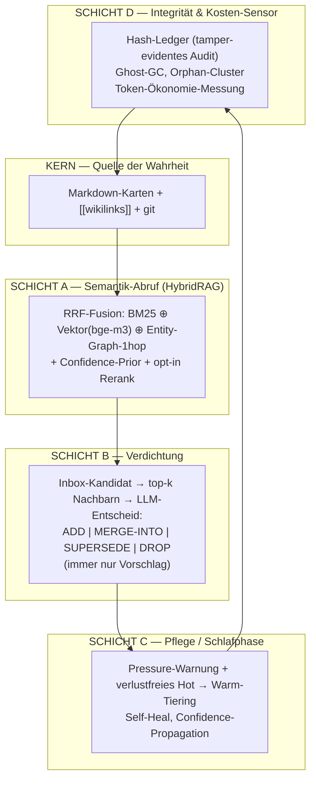
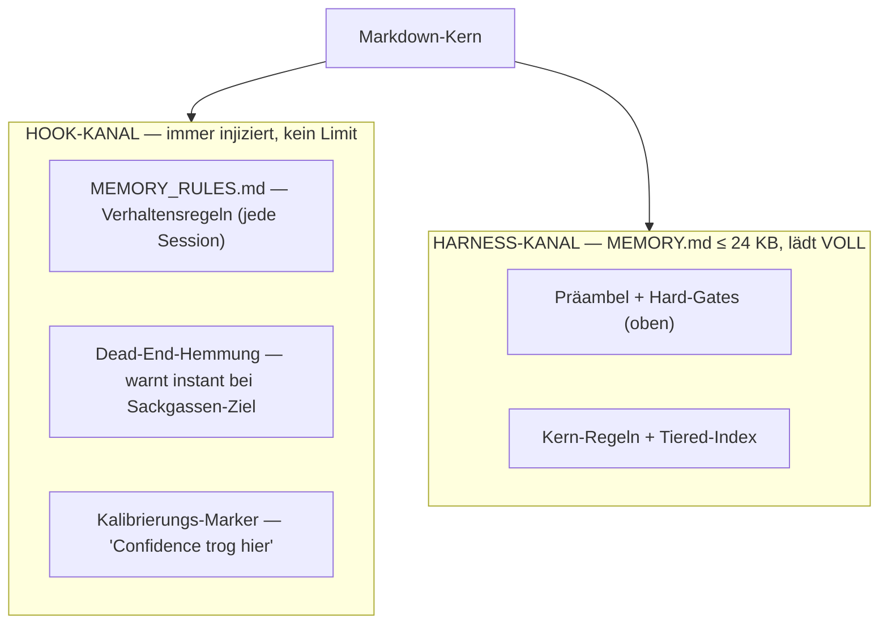

# Architektur

`markmem` veredelt ein laufendes Markdown-Notizsystem mit fünf Schichten. Der Leitsatz: **kein zweites Gedächtnis daneben** — Markdown + git bleibt die alleinige Quelle der Wahrheit, alle Indizes sind abgeleitet und jederzeit neu baubar.

---

## KERN — Markdown + git

Jede Notiz ist eine atomare `.md`-Karte. Vorteile dieser Wahl gegenüber einer DB:

- **auditierbar** — jede Änderung steht im git-Log, mit Autor, Zeit und Diff.
- **kein Lock-in** — menschenlesbar, mit jedem Editor pflegbar, ohne Tooling lesbar.
- **robust** — ein Crash oder ein korrupter Index ist folgenlos: einfach neu indizieren.

Karten verlinken sich per `[[wikilinks]]`. Diese Links sind die Kanten des Entity-Graphen — sie entstehen gratis aus dem git-Inhalt, ohne LLM-Triple-Extraktion (die nur Halluzinations-Kanten erzeugen würde).

Chunking erfolgt **pro Markdown-Sektion** (`##`): kleine Dateien sind ein Chunk, lange Index-Dateien werden pro Abschnitt aufgeteilt, der Header-Pfad dient als Präfix.

---

## SCHICHT A — Semantik-Abruf (HybridRAG)

Drei (optional vier) Ranglisten werden per gewichtetem Reciprocal Rank Fusion zusammengeführt:

1. **BM25** — exakte Term-Treffer, Kürzel, Eigennamen.
2. **Entity-Graph** — 1-Hop-Expansion über `[[wikilinks]]` und Ko-Okkurrenz-Kanten.
3. **Vektor** — bge-m3-Embeddings (1024d, multilingual), numpy-Brute-Force-Cosine. Das findet „über die Ecke": eine englische Anfrage trifft eine deutsche Karte.
4. **Cross-Encoder-Rerank** *(opt-in)* — `bge-reranker-v2-m3`, top-20 → top-5.

Details und gemessene Zahlen: [retrieval.md](retrieval.md).

---

## SCHICHT B — Verdichtung

Gegen den „Müllhalden-Effekt" (Inbox-Stau): für jeden Roh-Kandidaten werden zuerst die top-k Nachbarn geholt (Vektor + Jaccard), dann entscheidet ein LLM genau **eine** Operation:

| Op | Bedeutung |
|---|---|
| `ADD` | neues, distinktes Wissen — als Karte aufnehmen |
| `MERGE-INTO [[x]]` | in eine bestehende Karte einarbeiten |
| `SUPERSEDE` | ältere Karte ablösen (nie hart löschen — `superseded:`-Frontmatter / Dead-End-Ordner) |
| `DROP` | redundant / wertlos — verwerfen |

Wichtig: Der Output ist **immer nur ein Vorschlag**. Verhaltensänderndes Wissen wird nie automatisch geschrieben — ein Review-Gate (`/memory-review`) bleibt dazwischen. Die LLM-Rolle ist hybrid: lokale Extraktion/Triage (gratis, Intel bleibt lokal) + Cloud-Synthese nur für Merge/Widerspruch.

---

## SCHICHT C — Pflege / Tiering

Eine regelbasierte „Schlafphase" (Stop-Hook + optionaler Cron) hält das Gedächtnis schlank:

- **Pressure-Warnung**, wenn die immer-geladene `MEMORY.md` sich dem Lade-Limit nähert.
- **verlustfreies Hot → Warm-Tiering**: historische, abgeschlossene Einträge wandern in `MEMORY_DEEP.md` (warm, on-demand semantisch abrufbar), aktive bleiben hot. Der Volltext bleibt erhalten, nur die Index-Präsenz wandert.
- **Self-Heal**: Ghost-GC (verwaiste Index-Chunks), Orphan-Cluster, Confidence-Propagation.

---

## SCHICHT D — Integrität & Kosten

- **Hash-Ledger** — tamper-evidentes Audit der Karten-Historie.
- **Token-Ökonomie-Sensor** — misst, wie viel Kontext-Budget das Gedächtnis kostet (die Disziplin, die den 71-KB-Überlauf überhaupt erst sichtbar gemacht hat).
- **Ghost-GC / Orphan-Cluster** im Audit-Lauf (`markmem-audit`).

---

## Die zentrale Innovation — Zwei-Kanal-Laden

Das schärfste Designproblem war nicht das Finden, sondern das **garantierte Laden** der kritischen Regeln. Sie sind allein ~24 KB groß und würden das harte Lade-Limit der immer-geladenen `MEMORY.md` sprengen — mit dem heimtückischen Effekt, dass die wichtigsten Regeln am unteren Rand **stillschweigend abgeschnitten** würden.

Die Lösung: Regeln liegen in `MEMORY_RULES.md` und werden vom SessionStart-Hook über einen **eigenen Kontext-Kanal** injiziert, der nicht vom Limit der `MEMORY.md` betroffen ist. Ergebnis:

- **nichts Kritisches wird je abgeschnitten** (die Hard-Gates sind garantiert im Kontext),
- beide Dateien bleiben klein und schnell ladbar.

In einer Beispielmessung auf einem privaten Korpus schrumpfte die immer-geladene `MEMORY.md` von 71 KB (überlief das Limit) auf 21 KB (lädt wieder voll), während Hook-Kanal (~9 KB) und Warm-Tier (~55 KB, on-demand) den Rest tragen.

---

## Prinzipien (gelten überall)

- **Fail-open beim Abruf** — ein Synapsen-Fehler blockiert nie die Session. **Fail-closed** nur bei riskanten Schreib-Aktionen.
- **Nur Vorschläge** für verhaltensänderndes Wissen — Review-Gate dazwischen.
- **Secret-Scan vor jedem Schreibvorgang**; sensibles Material bevorzugt lokal verarbeiten.
- **Stale-Chunk-Disziplin** — Reindex löscht geänderte/gelöschte Chunks (eine teuer gelernte Prod-Lehre).
- **Modellwechsel = Voll-Reindex** (768d ↔ 1024d sind inkompatibel).
- **Keine Daemons** — Hooks sind der Bus.
