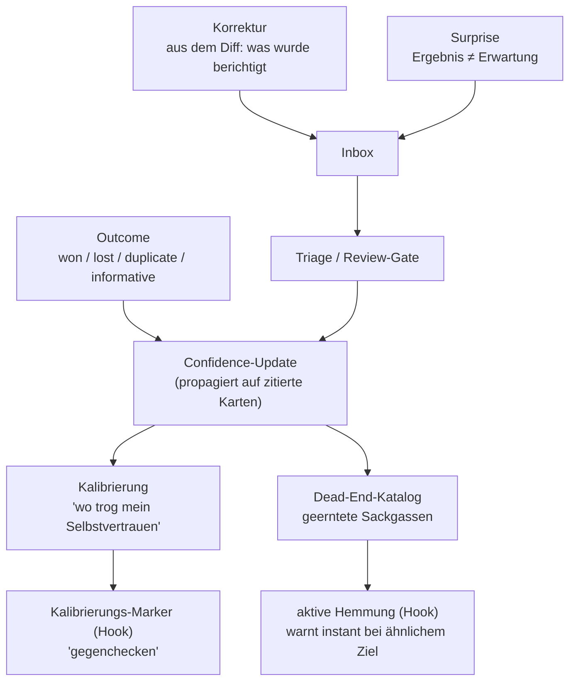

# Lern-Schleife

Die meisten „Memory"-Systeme können nur *hinzufügen*. `markmem` lernt zusätzlich aus dem, was tatsächlich passiert — aus Korrekturen, Überraschungen, Ergebnissen und vor allem aus **bewiesenen Sackgassen**. Das ist die Schicht, die fast jedes System weglässt.

---

## Die fünf Säulen

### 1. Korrektur (aus dem Diff)
Wenn eine Annahme korrigiert wird, lernt das System aus dem **Diff** zwischen dem, was angenommen wurde, und dem, was sich als richtig erwies — nicht aus einer neuen Behauptung im Vakuum. Die Korrektur landet als Kandidat in der Inbox.

### 2. Surprise
Ein Ergebnis, das deutlich von der Erwartung abweicht, wird als **Surprise** erfasst. Surprises sind die wertvollsten Lern-Signale, weil sie auf eine Lücke oder einen Irrtum im Modell zeigen. Sie gehen durch die Triage.

### 3. Outcome
Wird ein Vorhaben aufgelöst (`won` / `lost` / `duplicate` / `informative`), **propagiert** das Ergebnis die Confidence auf alle Karten zurück, die dabei zitiert wurden. So sammeln gute Karten Vertrauen, schlechte verlieren es — datengetrieben, nicht nach Gefühl.

### 4. Dead-End-Katalog + aktive Hemmung
Das Herzstück. Bewiesene Sackgassen (Vorhaben, die nachweislich ins Leere liefen) werden von `markmem-deadends` in ein **semantisches Register** geerntet. Beim nächsten Sessionstart vergleicht der Hook das neue Ziel gegen dieses Register und **warnt sofort**, wenn es einem alten Reinfall ähnelt — *bevor* dieselbe Zeit ein zweites Mal verbrannt wird.

> Negativ-Wissen ist das, was fast jedes Memory-System wegwirft. Hier ist es ein aktiver Schutz: „Das hast du schon einmal probiert, und es war eine Sackgasse — hier ist warum."

Generalisiert ist das ein **Dead-End/Negativ-Wissen-Katalog** über beliebige Domänen (Standard-Glob `*/DEADEND.md`, konfigurierbar — siehe [konfiguration.md](konfiguration.md)).

### 5. Kalibrierung
`markmem` analysiert die Outcome-Historie auf die Frage **„wo trog mein Selbstvertrauen?"** — Fälle, in denen hohe Confidence falsch lag. Diese Karten bekommen einen **Kalibrierungs-Marker**, den der Hook injiziert: „Confidence trog hier — gegenchecken." Das dämpft systematische Selbstüberschätzung.

---

## Wie es in den Kontext kommt

Die Lern-Schicht wirkt **über den Hook-Kanal** (siehe [architektur.md](architektur.md)) — also außerhalb des `MEMORY.md`-Lade-Limits:

- **Dead-End-Hemmung** → instant-Warnung bei Sackgassen-ähnlichem Ziel.
- **Kalibrierungs-Marker** → „gegenchecken"-Hinweis bei miskalibrierten Karten.

Beides wird bei jeder Session frisch injiziert, ohne ein Limit zu sprengen.

---

## Review-Gate (kein Auto-Write)

Alle gelernten Kandidaten (Korrekturen, Surprises, Verdichtungs-Vorschläge) landen in der **Inbox** und werden **nie automatisch** zu permanentem Gedächtnis. Ein menschliches Review-Gate promotet gute Kandidaten und lehnt andere in einen Audit-Trail ab. Das hält das Prinzip „nur Vorschläge für verhaltensänderndes Wissen" durch.

In einer Beispielmessung auf einem privaten Korpus enthielt die Lern-Schicht u. a. 11 geerntete Dead-Ends, 4 als miskalibriert markierte Karten und eine review-bereite Inbox mit Surprises, Korrekturen und Verdichtungs-Chips (DROP/MERGE/ADD).
