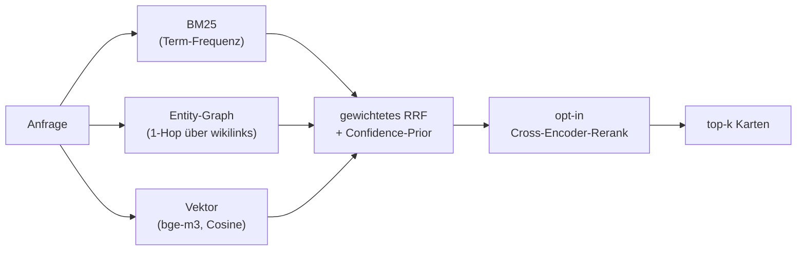

# Retrieval (HybridRAG)

`markmem-retrieve` beantwortet eine Anfrage, indem es mehrere unabhängige Ranglisten bildet und sie zu einer fusioniert. Kein einzelnes Bein gewinnt allein — die Stärke liegt in der Kombination.

---

## Die Beine

### BM25
Klassische Term-Frequenz/Inverse-Dokumentfrequenz. Stark bei exakten Treffern, Kürzeln und Eigennamen, die ein Embedding-Modell „verwischt".

### Entity-Graph
1-Hop-Expansion über `[[wikilinks]]` und Ko-Okkurrenz-Kanten. Holt benachbarte Karten dazu, die thematisch verbunden, aber lexikalisch verschieden sind. Sekundär-Ranking nach `degree` (gratis aus dem Graphen).

### Vektor
bge-m3 (1024d, multilingual DE+EN) über Ollama, gespeichert als SQLite-BLOB, verglichen per numpy-Brute-Force-Cosine. Bei wenigen tausend Vektoren liegt die Suche unter 10 ms — ein ANN-Index (Milvus o. ä.) wäre überdimensioniert und OOM-anfällig. Das ist das „über die Ecke finden": eine englische Frage trifft eine deutsche Karte, weil die Bedeutung, nicht das Wort, matcht.

---

## RRF — Reciprocal Rank Fusion

Jede Karte bekommt pro Liste einen Score `1 / (k + rang)` und die gewichtete Summe über alle Beine. Vorteil gegenüber Score-Mittelung: RRF ist robust gegen unvergleichbare Score-Skalen (BM25-Punkte vs. Cosine-Ähnlichkeit). Die **Gewichte pro Bein** sind nicht geraten — sie werden vom Selbst-Tuner gegen Recall@1 optimiert (siehe [self-tuning.md](self-tuning.md)).

In einer Beispielmessung auf einem privaten Korpus ergab der Tuner: `bm25 1.0× · vector 2.5× · entity 0.5×` — das Vektor-Bein trägt am meisten, das Entity-Bein verfeinert.

---

## Confidence-Prior (opt-in / datenabhängig)

Optional moduliert ein **Confidence-Prior** das Ranking: Karten mit bewährter Outcome-Historie (oft korrekt gewesen) werden leicht hochgezogen. Steuerparameter ist `conf_beta`.

> **Ehrliche Lehre:** Auf dem getesteten Korpus maß der Tuner `conf_beta = 0` — der Prior war **wirkungslos**. Die Infrastruktur bleibt deshalb dormant statt aktiv. Das ist Absicht: ein Mechanismus, der nichts misst, soll nichts tun. Mit mehr echtem Outcome-Signal kann er sich später lohnen — dann zeigt der Tuner es.

---

## Reranker (opt-in)

Ein Cross-Encoder (`bge-reranker-v2-m3`) bewertet die top-20-Kandidaten paarweise gegen die Anfrage und sortiert auf top-5 um. Cross-Encoder sind genauer als reine Embedding-Ähnlichkeit, aber teuer.

> **Ehrliche Lehre:** Der Reranker hob Recall@1 in der Messung auf 0.93 (+6,6 % gegenüber dem Vektor-Default), kostet aber **20–60 s CPU** pro Lauf. Deshalb ist er **opt-in, nicht Default** — die Latenz lohnt sich nur, wenn maximale Präzision wichtiger ist als Geschwindigkeit. Fail-open: fehlen `torch`/`transformers`, läuft der Abruf ohne ihn weiter.

---

## Eval-Harness

`markmem-eval` misst die Abruf-Qualität reproduzierbar:

- **Gold-Set** aus Paraphrase-QA: pro Karte eine **keyword-freie** Umschreibung als Anfrage (kein lexikalisches Gratis-Match), die richtige Karte als Gold-Antwort.
- **Metriken:** Recall@1 (richtige Karte auf Platz 1) und MRR (mittlerer reziproker Rang).
- **A/B-Modus:** Baseline vs. + Vektor vs. + Rerank, plus Gold-Set-Dump zur Inspektion.

**Recall@1-Treppe** *(Beispielmessung auf einem privaten Korpus, Gold-Set n≈30–35):*

| Konfiguration | Recall@1 | MRR |
|---|---|---|
| BM25 + Entity (Baseline) | 0.73 | 0.79 |
| **+ Vektor-Bein (Default)** | **0.87** | 0.88 |
| + Cross-Encoder (opt-in) | **0.93** | 0.93 |
| Selbst-getunt (vector 2.5×) | 0.80 → **0.857** | 0.86 → 0.895 |

---

## Self-Tuner

`markmem-tune` führt eine Grid-Search über die RRF-Gewichte und `conf_beta` durch und schreibt die beste Konfiguration nach `retrieval_config.json`. Der Kreislauf Eval → Tune → Config → re-Eval ist in [self-tuning.md](self-tuning.md) beschrieben.

---

## Indexierung

`markmem-index` bettet alle Karten ein:

- **inkrementell** per git-diff/mtime — nur geänderte Karten neu einbetten (Schnellpfad).
- **Stale-Chunk-Disziplin** — geänderte/gelöschte Chunks werden beim Reindex *entfernt* (sonst liefert die Suche veraltete Treffer; teuer gelernte Prod-Lehre).
- **Secret-Redaktion** vor dem Einbetten.
- **Chunk-Cap** pro Karte gegen Ausreißer.

Index-Dateien (`*.sqlite`) sind generierte Artefakte und stehen in der `.gitignore` — sie werden nie eingecheckt.
