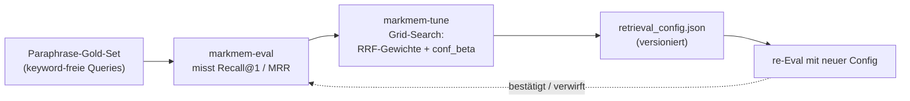

# Self-Tuning

`markmem` schließt die Schleife auf sich selbst zurück: es **misst** seine Abruf-Qualität und **stellt seine eigenen Such-Gewichte** danach ein. „So nah an selbstlernend, wie es ohne Gewichts-Update am Modell geht."

---

## Schritt 1 — Messen (`markmem-eval`)

Der Eval-Harness baut ein **Gold-Set** aus Paraphrase-QA: zu jeder Karte eine umgeschriebene, **keyword-freie** Anfrage (damit kein lexikalisches Gratis-Match die Messung schönt) und die richtige Karte als Soll-Antwort. Gemessen werden:

- **Recall@1** — wie oft die richtige Karte auf Platz 1 landet.
- **MRR** — mittlerer reziproker Rang.

Der Harness fährt A/B (Baseline vs. + Vektor vs. + Rerank) und kann das Gold-Set zur Inspektion dumpen.

---

## Schritt 2 — Tunen (`markmem-tune`)

Der Tuner führt eine **Grid-Search** über die Suchparameter durch und maximiert Recall@1:

- **RRF-Gewichte** pro Bein (`bm25`, `vector`, `entity`),
- **`conf_beta`** (Stärke des Confidence-Prior).

Das Ergebnis wird versioniert nach `retrieval_config.json` geschrieben. Diese Datei steuert anschließend `markmem-retrieve` — die Suche benutzt also genau die Gewichte, die sich messbar bewährt haben.

In einer Beispielmessung auf einem privaten Korpus fand der Tuner `bm25 1.0× · vector 2.5× · entity 0.5×` und hob damit Recall@1 von 0.80 auf 0.857.

---

## Schritt 3 — Re-Eval

Mit der neuen Config wird erneut evaluiert. Verbessert sich die Metrik, bleibt die Config; verschlechtert sie sich (Overfitting aufs Gold-Set), wird verworfen. Der Kreislauf ist idempotent und versioniert — jede Config-Änderung ist nachvollziehbar.

---

## Warum das der eigentliche Wert ist

Der Tuner darf — und soll — **eigene Ideen verwerfen**, wenn die Zahlen Nein sagen:

| Idee | Erwartung | Messung | Entscheidung |
|---|---|---|---|
| **Confidence-Prior** | bewährte Karten höher ranken | `conf_beta = 0` (wirkungslos auf dem Korpus) | Infrastruktur bleibt **dormant** |
| **Reranker als Default** | bessere Präzision | +6,6 % Recall@1, aber 20–60 s CPU | nur **opt-in** |

> Der Eval-Harness trennt „klingt klug" von „ist messbar besser". Ein System, das seine eigenen guten Ideen verwerfen kann, wenn die Daten widersprechen, ist mehr wert als eines, das jede plausible Idee einbaut. Beide Mechanismen bleiben gebaut und aktivierbar — sie schalten sich ein, sobald die Metrik es rechtfertigt.

---

## Wann lohnt sich erneutes Tunen?

- nach größerem Korpus-Wachstum oder thematischer Verschiebung,
- nach einem Embedding-Modellwechsel (dann ohnehin Voll-Reindex),
- wenn genug echtes Outcome-Signal aufgelaufen ist (dann kann der Confidence-Prior aus seiner Dormanz aufwachen).

> **Größter nächster Hebel ist Nutzung, nicht Code:** Korrektur-, Outcome- und Kalibrierungs-Daten wachsen nur durch echte Sessions. Mit echtem Signal wird der Tuner schärfer.
